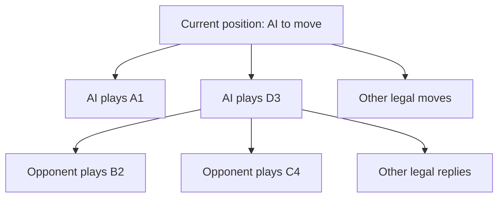

# How AlphaTic's AI works

AlphaTic combines two ways of deciding what to do: a **neural network** makes a quick judgment about a board, and a **tree search** looks ahead at possible moves and replies. The search uses the network's judgments to decide which possibilities deserve more attention.

This guide explains the implementation in this project. You do not need any machine-learning background to follow it.

## 1. What is the AI trying to do?

The board has 6 × 6 squares. By default, the first player to connect four marks horizontally, vertically, or diagonally wins. The required line length can be changed.

A **position** means the board plus whose turn it is. When the AI receives a position, it must choose one empty square. It cannot examine every possible future game: even the empty board offers 36 choices, followed by 35 possible replies, then 34 choices, and so on until a game ends.

Instead, it spends a limited amount of effort investigating promising continuations.

## 2. The neural network answers two questions

A neural network is a calculation with adjustable numbers called **weights**. Training changes those weights so that its answers better match examples.

Our network takes a position and returns two answers:

| Answer | Meaning | Example |
| --- | --- | --- |
| **Policy** | How much initial attention should each legal move receive? | “Give D3 25% of the initial preference.” |
| **Value** | How favorable does this position look for the player whose turn it is? | “This position looks somewhat favorable: +0.4.” |

The policy's numbers sum to 1 across legal moves. A policy score of 25% does **not** mean that move has a 25% chance of winning. It is a preference used to guide search.

The value lies between −1 and +1:

- **+1** corresponds to a win for the player to move.
- **−1** corresponds to a loss for that player.
- **0** is neutral; it can reflect a draw or uncertainty between good and bad outcomes.

Predictions can be wrong. A value of +0.4 is not a calibrated 70% win probability, and a value near zero does not prove the game is a draw.

### How the network reads the board

The network sees three lists of 36 numbers:

1. Where the current player's marks are.
2. Where the opponent's marks are.
3. Where the empty squares are.

Each entry is either 0 or 1, giving 108 inputs altogether. Describing the board as “mine” and “theirs” lets the same network play either X or O.

Those inputs feed a shared layer of 64 computational units. Each unit combines its inputs using learned weights, then applies a curved function called `tanh`. That curve allows the network to represent relationships more complicated than simply adding up marks.

The shared layer feeds two outputs, called **heads**:

- The policy head produces 36 move scores. Occupied squares are excluded, and the remaining scores are converted into probabilities using a calculation called *softmax*.
- The value head produces one number, with `tanh` keeping it between −1 and +1.

There is no hand-written position score blended into these predictions. If the game has already ended, the search uses the exact result from the rules instead of asking the network to guess.

## 3. The tree represents possible futures

Imagine the current position at the top of a diagram. Each move leads to a new position; each opponent reply leads to another position.



Each position in this diagram is a **node**. The starting node is the **root**. A position reached by one move is a **child** of its previous position, or **parent**. A node without children in the current search tree is a **leaf**; it may simply be unexplored, rather than a finished game.

The AI builds only part of this tree. Every time it expands an unfinished position, it creates children for all legal moves, but it does not investigate them equally.

## 4. One search simulation, step by step

The search is called **Monte Carlo Tree Search**, or **MCTS**, using a move-selection rule called **PUCT**. In this implementation, a “simulation” is one trip down the tree and back. It does not mean playing an entire random game to the end.

Each simulation has four parts.

### Select a path

Starting at the root, choose a child, then another child, until reaching a leaf. At each choice, balance two questions:

- Which move has looked best in the search so far?
- Which move is promising enough that we should investigate it more?

The first is **exploitation**: use what we have learned. The second is **exploration**: spend effort learning more.

### Evaluate the leaf

If the position is finished, use its exact win, loss, or draw result. Otherwise, ask the neural network for its policy and value.

### Expand the leaf

For an unfinished position, create a child for every legal move. Store each move's network policy probability as its **prior**: the initial preference before searching that move more deeply.

The implementation evaluates the position and creates its children in the same search step.

### Send the result back up

Walk backward along the selected path. At every visited node:

- Increase its visit count by one.
- Add this simulation's value to its running total.

The average value is the total divided by the visit count. This updating process is called **backup**; it means passing information back through the tree.

### Why the value changes sign

Players have opposite goals. If a position looks good for X, it looks bad for O.

Suppose the AI is X and considers a move. At the resulting position, O is next to play. If the network evaluates that position as −0.6 for O, the same estimate is +0.6 for X.

Internally, every node stores values from its own player-to-move perspective. Backup therefore reverses the sign at every step up the tree.

## 5. How PUCT chooses a branch

Each child has three useful numbers:

| Symbol | Meaning |
| --- | --- |
| **P** | The move's policy prior from its parent position |
| **N** | How many simulations have visited this node |
| **Q** | The average value backed up through this node |

The code chooses the child with the largest score:

```text
score = -Q(child)
        + 1.6 × P(child) × sqrt(max(1, N(parent))) / (1 + N(child))
```

The `-Q(child)` term converts the child's value into the parent's perspective. It rewards moves that have looked favorable for the player making the choice.

The rest is an **exploration bonus**. It is larger when the network favors the move, smaller when the child has already received many visits, and grows as the parent receives more visits. The constant `1.6` controls the strength of exploration.

For example, a frequently visited move may have a good average value, while a less-explored move has a stronger prior. The bonus can make the AI investigate the second move to see whether it is even better. That investigation can change its average value and affect later choices.

Unvisited children begin with an average value of zero. This is a starting convention, not evidence that their positions are draws.

## 6. How the AI finally picks a move

During normal play, the default budget is **800 simulations per AI turn**. The first simulation evaluates and expands the root; later simulations investigate its branches.

After the budget is used, the AI plays the root child with the **most visits**. If visit counts tie, the larger prior breaks the tie.

It does not simply pick the network's favorite move, or the child with the highest value after one visit. The visit counts reflect how search allocated its attention after considering replies and deeper positions.

A new search tree is built for each AI turn. Searching changes the tree's statistics; it does **not** change the neural network's weights during an ordinary game.

## 7. How the network learns through self-play

Training is a separate mode in which the AI plays both sides. The network starts with random weights when training a new checkpoint. It is used from the first game onward.

For every move, the trainer records:

- The position before the move.
- The search's visit distribution across legal moves.

For example, if three moves receive 60, 30, and 10 visits, their training targets are 0.6, 0.3, and 0.1. The network learns to predict where search spent its effort.

After the game ends, each recorded position also receives a value target: +1 if its player to move eventually won, −1 if that player lost, or 0 for a draw. This outcome belongs to the game actually played; it is not proof of what perfect play would achieve.

Training then adjusts the network to better predict both targets:

- **Policy error** measures disagreement with the search's move distribution.
- **Value error** measures disagreement with the final outcome.

The code uses *gradient descent*: it calculates how the weights contributed to those errors and makes small adjustments intended to reduce them. Repeating this creates a learning loop:

```text
Current network → self-play searches → training examples → updated network
```

Several details make the examples more varied:

- Training mixes random noise into the root's policy priors: 75% network prior and 25% noise. This encourages trying different openings.
- For the first ten moves of each training game, moves are sampled according to search visits. Later moves use the most-visited choice.
- Each recorded position and policy is rotated and reflected into eight equivalent examples.
- A **replay buffer** retains up to 16,000 examples. After each game, training performs 20 updates using randomly sampled batches of up to 64 examples.

The training simulation setting counts searches after an initial root-expansion step. Thus `--simulations 128` produces 129 root visits per training move, with 128 visits distributed among root children.

After every game, the weights and total training game count are saved in a **checkpoint** file. Resuming training restores those weights; the in-memory replay buffer starts fresh.

## 8. What the game display tells you

The tree panel displays the actual search, with miniature boards for the positions it has created.

- **N** shows visits. More visits mean more search attention, not necessarily a winning move.
- **P** shows the initial policy prior for that move.
- **Q** shows the average backed-up value, combining neural estimates and any exact terminal results encountered.

For readability, the UI converts every displayed Q into the **search root player's perspective**. If the searching player is O, positive displayed values favor O everywhere in that tree. This differs from the alternating player perspectives stored internally.

Gold borders mark the most recent simulation's path. Brighter empty squares on the main board received more visits. The main board's gold outline instead marks the last move played.

To watch the process slowly, press **Space** during the AI's turn to pause, then **S** to perform one simulation at a time. Click tree nodes to explore their continuations. **Up** returns to the parent, and **Root** returns to the starting position. The previous search remains visible after the AI moves.

## 9. What to expect from the current model

The standard four-in-a-row game loads a starter network trained for **300 self-play games**, using 128 simulations after root expansion per move. Its playing strength has not been benchmarked. More search can help it investigate its predictions, but neither a large search budget nor more training guarantees perfect play.

Other win lengths use a fresh network labeled `untrained` unless a matching checkpoint is supplied. There is no automatic heuristic fallback. The old `TacticalEvaluator` class remains for baseline tests; normal play and self-play training use the neural network.

The design follows the policy/value-plus-search approach associated with AlphaGo and AlphaZero, on a much smaller scale. It is a small educational implementation, not a reproduction of their full training systems.

For running and training commands, see [README.md](README.md). To connect this explanation to the code:

| File | What to look for |
| --- | --- |
| [game.py](src/alphatic/game.py) | Positions, legal moves, and exact game outcomes |
| [network.py](src/alphatic/network.py) | Board encoding, policy/value predictions, and self-play training |
| [search.py](src/alphatic/search.py) | PUCT selection, tree expansion, value backup, and final move choice |
| [app.py](src/alphatic/app.py) | Search controls and the displayed tree statistics |
